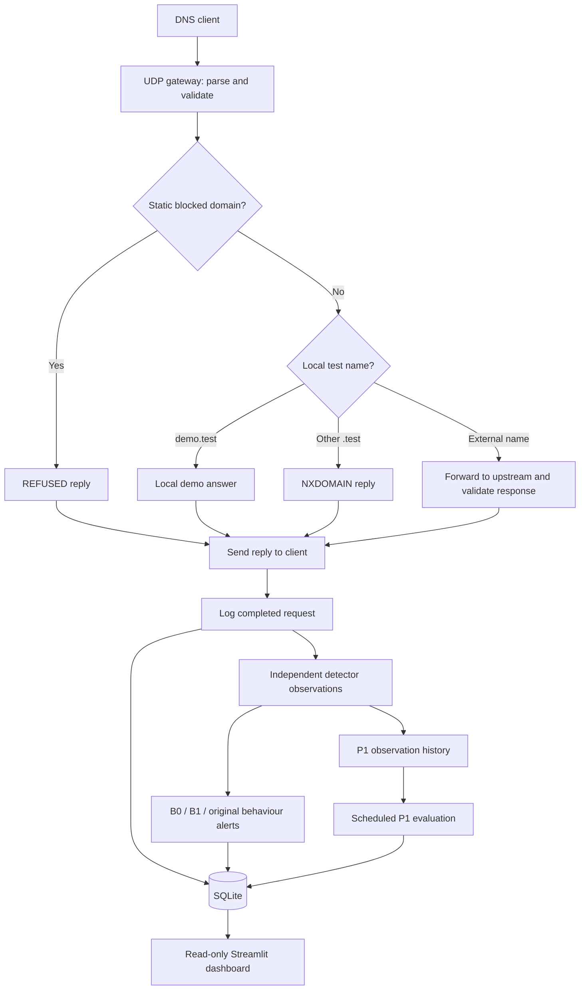
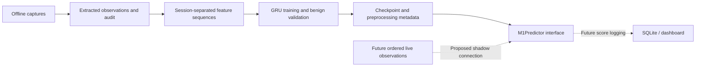

# Architecture and request flow

[Documentation index](README.md) · [Detectors](detectors.md) · [Operating guide](running-and-troubleshooting.md)

## The basic idea

DNS translates a name such as `example.com` into information such as an IP
address. Attackers can also put encoded data into DNS names. DNSentinel answers
or forwards DNS requests while recording activity and looking for suspicious
patterns.

Current gateway settings in [`dns_server.py`](../dns_server.py):

| Setting | Current value | Meaning |
|---|---|---|
| Listen address | `127.0.0.1` | Accessible from this computer's loopback interface. |
| Listen port | `5300` | Clients must explicitly target this port. |
| Transport | UDP | This gateway does not implement DNS-over-TCP. |
| Upstream | `1.1.1.1:53` | Resolver used for applicable external names. |
| Runtime database | `dns_events.db` beside the server script | Local SQLite activity, alerts and P1 state. |

Starting the script does not automatically configure Windows or browser DNS.
The project client deliberately targets `127.0.0.1:5300`.

## One request, from arrival to dashboard

1. The server parses a DNS datagram. It ignores response packets received as
   requests and rejects unsupported question counts/opcodes with `FORMERR`.
2. A domain in the static blocklist, or one of its subdomains, receives
   `REFUSED`. Defaults are `blocked.test`, `malware.test`, and `phishing.test`.
3. `demo.test` has a local A answer, `192.0.2.10`. An AAAA query receives a
   successful response without an IPv6 answer. Other `.test` names receive
   `NXDOMAIN` locally.
4. External requests are forwarded. The reply's transaction ID, response flag
   and question are checked. Upstream/network errors produce `SERVFAIL`.
5. The reply is sent, then the completed transaction is logged and observed by
   the detectors. Their warnings are separate from the client's DNS answer.
6. P1 evaluates on a roughly five-second schedule. The server's receive timeout
   permits evaluation when idle, but request processing can delay scheduling;
   this is not a hard real-time service.
7. The dashboard refreshes from SQLite approximately every three seconds.

## Server decisions and security judgments are different

| Log status | Meaning |
|---|---|
| `LOCAL` | The server handled the demo name locally. |
| `LOCAL_TEST` | Another `.test` name was answered locally with NXDOMAIN. |
| `FORWARDED` | A valid upstream response was obtained. |
| `BLOCKED` | The static domain blocklist refused the request. |
| `ERROR` | An upstream operation failed; the server generated SERVFAIL. |

`NOERROR` means the DNS operation succeeded, not that a domain is safe.
`NXDOMAIN` means the name does not exist, not that the query was malicious.
A security alert can coexist with either response.

## SQLite storage

| Table | Contents | Used by |
|---|---|---|
| `dns_logs` | Timestamp, client IP, domain, type, server status and response code. | Activity and traffic analysis. |
| `dns_alerts` | Detector, risk, explanations, and optional score/rule/incident details. | B0 (`BASELINE`), original behaviour (`BEHAVIOUR`), and B1. |
| `p1_transitions` | Previous/new state, client/parent, evidence, features and samples. | P1 historical explanations. |
| `p1_current` | Latest saved state/evidence/features per client/parent. | P1 current-state view. |

B1's optional columns include `triggered_rules`, `features_json`,
`rule_details_json`, `incident_id`, `configuration`, `last_seen`, and
`occurrences`. Repeated updates to one incident do not represent independent
attacks. P1 events are in their own tables, not general B1 alert rows.

Rolling detector histories live in memory and reset when the server restarts.
SQLite history persists. P1's current view is cleared on a successful server
startup; an expired pair can retain its final NORMAL snapshot until then.
Always read the evaluation timestamp rather than treating every displayed pair
as currently active.

Live rolling windows use monotonic time, which is suitable for elapsed durations.
B1/P1 persisted timestamps use UTC; ordinary request/B0/behaviour logs use local
time in the current implementation. Offline PCAP timestamps are epoch/UTC.
Account for these differences when correlating records.

## Where M1 fits

The dashed connections are planned, not implemented. M1 does not currently
alter replies, block requests or update the live dashboard.

Relevant files: [`dns_server.py`](../dns_server.py),
[`dashboard.py`](../dashboard.py), [`p1_dashboard.py`](../p1_dashboard.py),
[`ml/inference.py`](../ml/inference.py).
