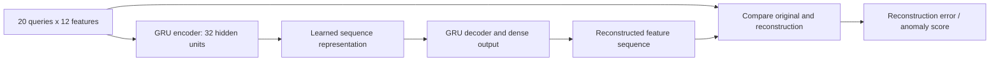

# Dataset and M1 training explained

[Documentation index](README.md) · [Full M1 reference](../README_M1.md) · [Glossary](glossary.md)

## What is the dataset?

CIC-Bell-DNS-EXF-2021 contains controlled benign traffic and DNS exfiltration
experiments. Exfiltration hides data in DNS requests sent to an attacker-controlled
domain. The project has 14 PCAP recordings: 2 benign, 6 light-attack and 6
heavy-attack captures.

The [publisher's description](https://www.unb.ca/cic/datasets/dns-exf-2021.html)
provides the collection method, attack scenarios and clock schedules. Local
capture/session timing and individual query labels still require verification.
Background services also make legitimate queries during attack recordings.
The `capture_group` column tells us a recording's origin, not whether every
query in it is malicious.

## Why extraction quality matters

[`prepare_gru_dataset.py`](../prepare_gru_dataset.py) extracts complete DNS
questions and response associations from classic Ethernet PCAP/UDP port 53.
The all-capture CSV has the following source-category counts:

| Origin | Extracted observations |
|---|---:|
| Benign recordings | 84,000 |
| Light-attack recordings | 76 |
| Heavy-attack recordings | 759 |
| Total | 84,835 |

The small attack count is mainly a **capture truncation problem**. These files
have a 96-byte snapshot limit. For a basic Ethernet/IPv4/UDP frame, headers use
42 bytes, leaving about 54 bytes of DNS data. A long encoded DNS question may
not fit, even though its DNS header was captured.

The independent [audit](../models/gru/dataset_audit.json) found:

- 252,447 UDP/53 queries in the attack recordings.
- 251,612 incomplete question failures in truncated attack packets.
- `light_image.pcap`: 489 DNS queries, all incomplete; zero complete observations.
- TShark also found zero additional complete questions missing from the CSV.
- One recovered name under the publisher's exfiltration domain is a label-review
  candidate; it does not establish representative labelled attack sequences.

The extractor cannot recreate missing bytes. Recovered short/background names
are not a representative replacement for the lost attack questions.

The CSV also has 564 missing responses and 46,087 ambiguous response timing rows.
Repeated outstanding questions are retained and flagged; they can be retries
or duplicate capture observations. TShark's response linkage and the extractor's
FIFO header/question associations differ substantially. Neither linkage count
establishes complete exchange ground truth. The original extractor matches
before sorting queries, so capture timestamp regressions can also lose matches.
No response values were silently replaced during M1 preparation.

## Why the first model is benign-only

A supervised classifier needs trustworthy benign/attack targets. Assigning the
attack label to every surviving query from an attack recording would train it
on misleading labels. The first valid experiment instead uses the
publisher-designated benign recordings as an explicit **benign-reference
assumption**, not independently verified per-query ground truth.

M1 is a **GRU sequence autoencoder**:

The encoder learns a compact representation of a sequence. The decoder tries
to reproduce its numerical measurements. Training adjusts weights to reduce
reconstruction error on the benign reference. A difficult-to-reconstruct
sequence later receives a larger anomaly score.

The model reconstructs feature values, not the original domain-name text. Its
decoder gets zero inputs conditioned on the encoder state, rather than being
given each correct input timestep as an easy copying shortcut.

## What goes into a sequence?

| Feature positions | Measurements |
|---|---|
| 1-4 | Leftmost label length, QNAME length, label entropy, label digit ratio. |
| 5 | Number of labels below the registered domain. |
| 6 | `log1p` of the previous-query gap; zero for the first query of each window. |
| 7-12 | One-hot A, AAAA, TXT, NULL, private-use 65280-65534, and other query types. |

The initial input is **20 x 12**, superseding the earlier provisional 20 x 8
idea. One-hot types avoid implying that DNS type numbers have an ordered
numeric meaning.

The gateway can produce these measurements. Model inputs exclude capture
names/categories, client/server identities, absolute timestamps, domain
identities, truncation/retry flags and response latency. Optional response
features are implemented but were disabled in this first run because of
matching uncertainty. Missing responses are never silently assumed NOERROR.

## Split and preprocessing

| Split | Recording | Full 20-query sequences | Queries used |
|---|---|---:|---:|
| Train | `benign_1.pcap` | 2,529 | 50,580 |
| Preliminary validation | `benign_2.pcap` | 1,670 | 33,400 |
| Independent test | None available | 0 | 0 |

Queries are grouped by capture/session and client, ordered chronologically and
split at idle gaps longer than 300 seconds. Windows have stride 20, so their
query rows do not overlap. Fourteen training tail queries and six validation
tail queries were excluded. Padding and packed-sequence support exist, but all
sequences in this run have full length, avoiding padding as a class cue.

Normalization is fitted to valid **training tokens only**. Training means and
scales are then applied unchanged to validation and inference. Metadata stays
in separate JSONL files; it is not fed into the GRU.

These are adjacent recordings from the same host/testbed, not independent
deployment environments. No random query-level split was used. The validation
capture selects the checkpoint; it is not an untouched final test set.

## The actual completed run

| Setting | Value |
|---|---|
| Mode | Benign-reference autoencoder |
| Encoder | One GRU layer, 32 hidden units |
| Batch | 64 sequences, each 20 x 12 |
| Dropout | 0.1 |
| Optimizer | AdamW, learning rate 0.001, weight decay 0.0001 |
| Loss | Masked per-sequence mean squared reconstruction error |
| Epochs | 10 completed; best validation result at epoch 10 |
| Seed/device | 42 / CPU |
| Checkpoint | Local `models/gru/m1_benign_ae/best.pt` |

| Measurement | Actual result |
|---|---:|
| Epoch 1 training loss | 0.50269618 |
| Epoch 10 training loss | 0.45653193 |
| Epoch 1 validation loss | 0.51217056 |
| Best validation loss | 0.46097860 |
| Final training error in evaluation mode | 0.45342292 |
| Training-derived anomaly threshold | 1.16123543 |
| Validation sequences above threshold | 8 / 1,670 (about 0.48%) |

The epoch training loss includes dropout and changing model weights. The
post-training evaluation error uses the selected model with dropout disabled;
the two training numbers therefore need not be equal.

The threshold is the 99th percentile of **training** reconstruction errors.
It is not a probability, and 1.1612 does not mean 116% maliciousness. The eight
validation exceedances are preliminary false-alarm candidates in benign
reference traffic. There is no verified attack precision, recall or F1 yet.

Actual run records:

- [Configuration](../models/gru/m1_benign_ae/model_config.json)
- [All epoch losses](../models/gru/m1_benign_ae/training_history.csv)
- [Evaluation metrics](../models/gru/m1_benign_ae/evaluation_metrics.json)
- [Feature schema](../models/gru/m1_benign_ae/feature_schema.json)
- [Normalization](../models/gru/m1_benign_ae/normalization.json)

## What exists and what remains?

Both autoencoder and supervised classifier code exist. Supervised preparation
rejects unverified manifests; the example manifest deliberately cannot train a
classifier as supplied. The supervised model has not been trained.

[`M1Predictor`](../ml/inference.py) can accept ordered observations, maintain
client/session buffers and return a score, threshold, model version, sequence
length and prediction timestamp. A bounded worker now connects it to the gateway
and stores results for the dashboard; see the [live demo guide](m1-live-demo.md).

Next: inspect flagged benign windows, obtain complete attack questions and
reviewed labels, and evaluate common held-out sessions against the rule detectors.
Shadow-mode logging/display are implemented. The present reconstruction
results do not establish that M1 detects attacks or outperforms B0/B1/P1.

## Dataset attribution

CIC-Bell-DNS-EXF-2021, Canadian Institute for Cybersecurity, University of New
Brunswick. Samaneh Mahdavifar et al., “Lightweight Hybrid Detection of Data
Exfiltration using DNS based on Machine Learning,” ICCNS, 2021.
