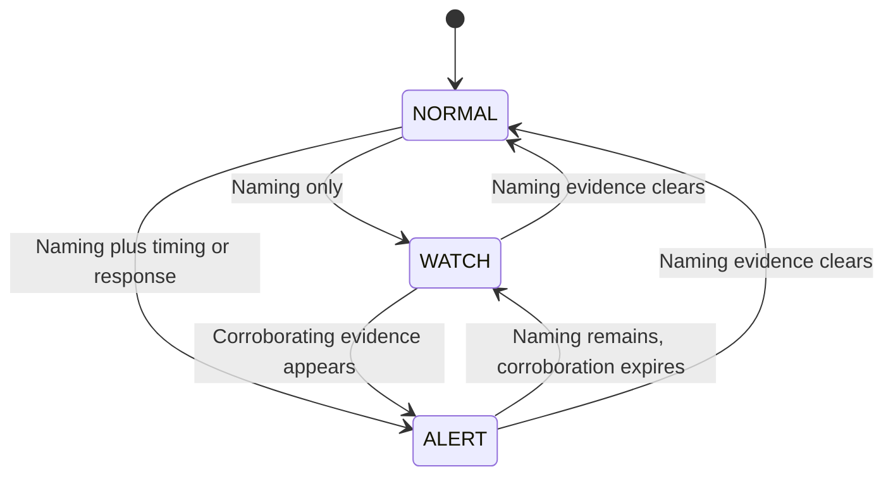

# Detectors explained

[Documentation index](README.md) · [Architecture](architecture.md) · [M1](dataset-and-m1.md)

The project compares several ways of observing the same kind of DNS activity.
Each detector keeps its own logic and state. An alert is evidence to investigate,
not proof of an attack.

| Component | Main question | Output |
|---|---|---|
| B0 | Does this individual name have a suspicious-looking leftmost label? | LOW/MEDIUM/HIGH with rule explanations. |
| Original behaviour detector | Are many different subdomains failing for this client/parent? | A HIGH alert with a cooldown. |
| B1 | Did any one of the enabled suspicious-pattern rules trigger? | An explainable, mergeable alert incident. |
| P1 | Is suspicious naming corroborated by timing or response evidence? | NORMAL, WATCH or ALERT state. |
| M1 | Does this sequence differ from learned benign behaviour? | Reconstruction anomaly score; currently offline/interface only. |

## B0: individual-query baseline

[`security.py`](../security.py) normalizes the DNS name and examines its
leftmost label. In `encoded.example.com`, that label is `encoded`.

- Length at least 30 characters contributes 50 points.
- Length at least 16 and Shannon entropy at least 3.5 bits/character contributes
  another 50 points.
- Score 0 is LOW, 50 is MEDIUM, and 100 is HIGH. Non-LOW results are logged under
  detector name `BASELINE`.

For example, 30 repetitions of `a` trigger the length condition even though
their character entropy is low. Entropy measures character diversity/distribution,
not intent. Scores are fixed severity indicators, not attack probabilities.

## Original rolling behaviour detector

[`behavior.py`](../behavior.py) now groups queries by client IP and registered
parent domain. It considers names with subdomains and NOERROR/NXDOMAIN responses.
For example, `a.example.co.uk` and `b.example.co.uk` share `example.co.uk`.

Its default alert requires **all** of:

- At least 5 queries within 60 seconds.
- At least 5 unique subdomain names in that window.
- At least 80% NXDOMAIN responses.

It suppresses repeated alerts for the pair for 60 seconds. Alerts are stored
as `BEHAVIOUR`, with a fixed HIGH/90 indicator. The current implementation is
not restricted to `demo.test`.

## B1: independent rules

[`b1_detector.py`](../b1_detector.py) uses **OR logic**: any enabled rule is
sufficient. Multiple rules found during one evaluation appear together.
Expanded, the default, enables all eight consecutive IDs:

| ID | Condition, using default thresholds |
|---|---|
| R1 | A leftmost label has at least 30 characters. |
| R2 | The same label has length at least 16 and entropy at least 3.5. |
| R3 | At least 3 distinct subdomains and uniqueness ratio at least 80% in 60 seconds. |
| R4 | At least 5 eligible queries in 15 seconds. |
| R5 | At least 4 NXDOMAIN responses and NXDOMAIN ratio at least 80% in 60 seconds. |
| R6 | A normalized full QNAME has at least 100 characters, without the trailing dot. |
| R7 | A name has at least 5 subdomain labels below its registered domain. |
| R8 | At least 10 combined TXT (16), NULL (10), or private-use type 65280-65534 queries in 60 seconds. |

Core enables R1-R5 only. All thresholds are configurable with `B1Thresholds`.
The unusual-type rule's current identifier is **R8**.

Observations are grouped by client and registered parent. Only completed
`FORWARDED`, `LOCAL`, or `LOCAL_TEST` observations with NOERROR/NXDOMAIN enter
the windows. REFUSED, SERVFAIL and upstream errors do not become NXDOMAIN
evidence. Numeric query type is used for private-use detection.

For R3, distinct subdomain names are divided by **all eligible queries** in
the group. A query to the parent itself contributes to the denominator, never
to the distinct-subdomain numerator. R7 counts subdomain labels, so
`a.b.example.co.uk` has depth 2, not 5.

Rules are evaluated on each eligible observation. R1/R2/R6/R7 can remain active
because of a qualifying name still present in the rolling window. The default
severity is MEDIUM and the score column is NULL.

### Incident merging

Continuing triggers for a client/parent merge into one SQLite incident. The
default cooldown is 60 seconds: a gap longer than that, or a clear evaluation,
ends the continuing incident. Server restarts reset the in-memory incident map.

- `triggered_rules` accumulates rule IDs seen during the incident.
- `features_json.active_rule_ids` describes the latest evaluation.
- `rule_details_json` retains each rule's last triggering measurements.
- `occurrences` counts merged triggering evaluations, not attacks or total queries.

An incident can therefore start with R3 and later add R5 and R4 without producing
three separate incident rows.

## P1: corroborated evidence and states

[`p1_detector.py`](../p1_detector.py) collects a 60-second rolling window per
client/registered parent and evaluates approximately every 5 seconds.
It accepts subdomain queries with the same allowed statuses and response codes
as B1. Parent-only queries are excluded from P1.

| Evidence family | When it is present |
|---|---|
| Naming | At least 3 unique names with uniqueness at least 80%, **or** a label length at least 30, **or** a length-at-least-16 label with entropy at least 3.5. |
| Timing | At least 5 queries in the last 15 seconds. |
| Response | At least 4 NXDOMAIN responses with NXDOMAIN ratio at least 80%. |

Several naming indicators still constitute **one evidence family**.

P1 is not required to visit WATCH before ALERT: a burst can establish all needed
evidence before the first scheduled evaluation. Timing or NXDOMAIN evidence
alone is insufficient for P1 ALERT, unlike B1's independent R4/R5 triggers.

### Example

Three different names below `walkthrough.test` return NXDOMAIN. Naming evidence
is present, so a scheduled evaluation can show WATCH. A fourth distinct failed
name reaches the response threshold and can produce ALERT. When the observations
age out, evidence clears and the state returns toward NORMAL.

The state is a current rule outcome. NORMAL is not a safety certificate, and
ALERT is not a calibrated maliciousness probability.

## Comparing detectors fairly

B1 Core and P1 use similar underlying naming/timing/response indicators, but
their decision logic differs. There are also operational differences: B1
evaluates per query and includes parent-only queries in its eligible counts;
P1 schedules evaluation and excludes parent-only queries. Align those
populations, timing and alert/incident definitions before claiming a controlled
performance comparison. Raw alert counts alone do not measure accuracy.
